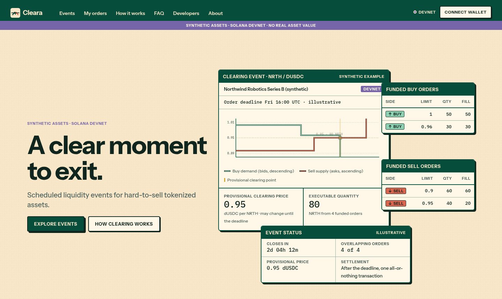
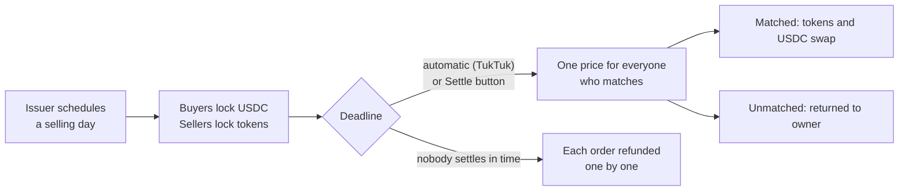
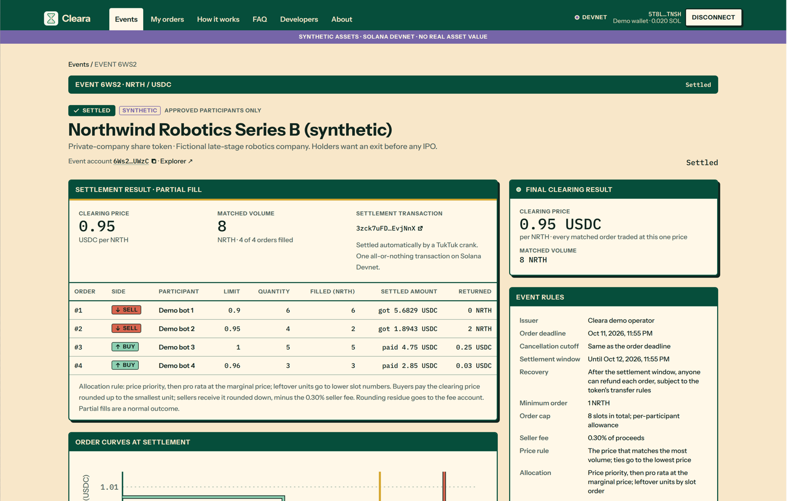
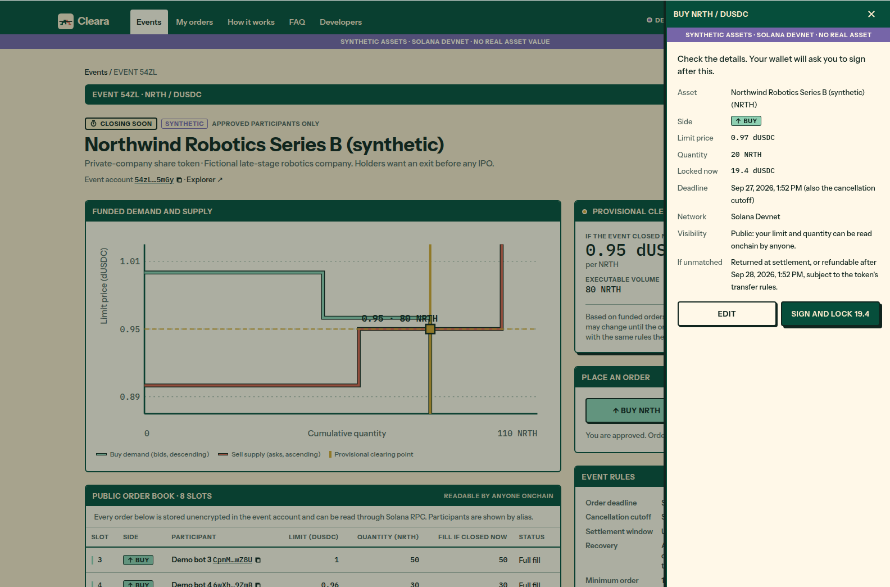
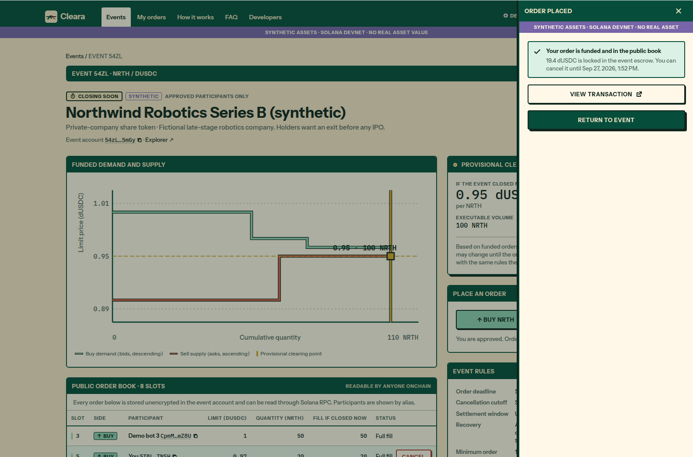
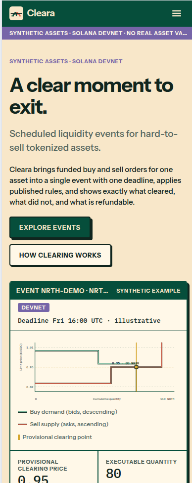
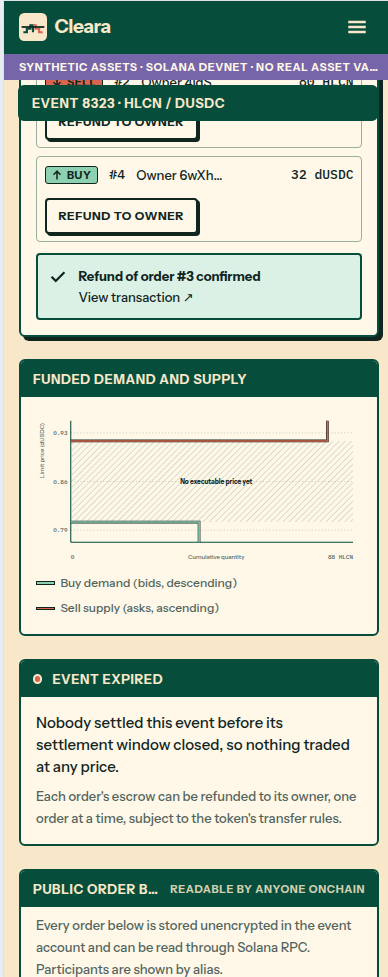
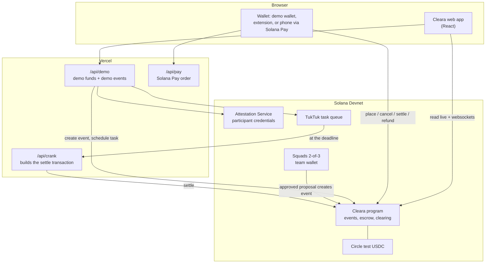

# Cleara

**A scheduled selling day for tokenized assets that are hard to sell.** Buyers and sellers place orders before a
deadline, then everyone who matches trades at one price, all at once.

Live demo: **https://cleara-ten.vercel.app** · Video: not available yet · Docs: this README and the in-app
[Developers page](https://cleara-ten.vercel.app/developers) · Submission: Colosseum Crypto World's Fair (not linked yet)

> Hackathon prototype. It runs on Solana's test network (Devnet) with made-up assets and free test money, so nothing
> here has real value.



Built with: Solana (Anchor program) · Circle test USDC · TukTuk auto-settle · Squads team wallet · Solana Attestation
Service · Solana Pay · React on Vercel

Status: working deployment on Solana Devnet. Synthetic assets, no real issuers or users yet.

## The problem

Some tokenized assets, like shares in a private company or a small real-estate token, are hard to sell. There are
few buyers, and the ones who exist rarely show up at the same time as the sellers. A holder who wants out on Tuesday
and a buyer who shows up on Friday never meet, so the market looks empty even when both sides exist.

Private markets solve this with scheduled windows (tender offers, periodic auctions) that bring everyone together at
one moment. Tokenized assets don't have that yet.

## What Cleara does

Cleara gives buyers and sellers of one asset a set time to meet.

- **One asset, one deadline, one price.** Everyone who matches pays or receives the same price.
- **Money and tokens are locked in the event** until it ends, so nobody has to trust a middleman to pay out.
- **It settles itself.** At the deadline the event is settled automatically, and a manual button stays as a backup.
- **Nothing gets stuck.** Anything that doesn't match goes back to its owner. If an event is never settled, every
  order can be refunded.

## How it works

1. **An issuer schedules an event** for one asset, with a deadline and a list of approved buyers and sellers.
2. **Approved people place orders** before the deadline: "I'll buy up to 50 at no more than 1.00 USDC each" or
   "I'll sell 40 at no less than 0.95". Their USDC or tokens are locked in the event. Everyone can see the orders.
3. **At the deadline, the event settles on its own.** Cleara finds the one price where the most buying and selling
   can happen. If the automatic run is late, anyone can press **Settle event now**.
4. **Everyone who matches trades at that price**, in one all-or-nothing transaction. The rest goes back to its owner.





## Why Solana

A whole event (up to 8 orders, every transfer and every refund) settles in **one transaction**, so either everyone
gets paid or nobody does. On Solana that transaction is fast and costs a fraction of a cent. The pieces a real issuer
would need also already exist on Solana, and Cleara uses each one at a specific step:

| Step in the flow | Tool | What it does in Cleara |
| --- | --- | --- |
| Paying for orders | **Circle test USDC** (Devnet) | Buyers lock real Circle test USDC, not a made-up dollar |
| Who may take part | **Solana Attestation Service** | Each approved wallet gets an onchain "approved participant" credential |
| Placing an order from a phone | **Solana Pay** | Scan a QR on the event page and sign the same order in a mobile wallet |
| Running the event as a company | **Squads** | An issuer's team wallet creates an event; any 2 of 3 members must approve |
| Settling at the deadline | **TukTuk** | A scheduled task settles the event automatically, no button press needed |
| Watching it happen | Solana websockets | Orders, settlements and refunds show up on the page as they land |

## What Cleara can't promise

- It can't create buyers. If nobody wants the asset, an event won't change that.
- The price is whatever the orders produce. It isn't a "fair value" estimate.
- Orders are public, so people can see the book and wait until the last minute.
- If the asset's issuer freezes or blocks a token, Cleara can't move it.

## Try it (about 5 minutes)

1. Open https://cleara-ten.vercel.app and click **Explore events**.
2. Click **Connect wallet** and choose **Cleara demo wallet (Devnet)**. It's a throwaway test wallet in your browser,
   with no extension or sign-up.
3. Under **Try it**, pick an asset and a starting order book, then click **Start demo event**. You get a 4-minute
   event with a few practice orders already in it, and the page shows **Auto-settle scheduled**.
4. Place a buy or sell order. If you need test tokens, click **Get demo funds**. Buy orders use Circle's free test
   USDC; if the demo pool is empty, get some at [faucet.circle.com](https://faucet.circle.com) (choose Solana Devnet).
   Or tap **Sign on your phone** to sign the same order from a mobile wallet with Solana Pay.
5. Watch the expected price update as orders change. You can cancel and re-place before the deadline.
6. When time runs out, wait a few seconds: the event settles itself and shows your receipt. If it hasn't after a
   minute, click **Settle event now**.
7. Open **My orders** for your history, or look at the other example events (finished, partly filled, expired, and
   one created by the 2-of-3 team wallet).

| Check before you confirm | Your order in the public book |
| --- | --- |
|  |  |

| Phone: home | Phone: expired event |
| --- | --- |
|  |  |

## What's proven, and what isn't

| Claim | Evidence | Where |
| --- | --- | --- |
| A live-site event settles itself at the deadline | Event [`6Ws2…UWzC`](https://cleara-ten.vercel.app/events/6Ws2NQ7342xQ3wvq6o7ZhCvDqHv9BQ4y2YREd35wUWzC) settled by TukTuk about 20 s after its deadline, no click: [tx](https://explorer.solana.com/tx/3zck7uFDQDbyupMhc5CEAYhcnfHNq4gVbUdS9VBx6BMjQVVFF63TJBhUewMjZK1CbPcpmji1EWSnCcfgNvEvjNnX?cluster=devnet) | Live site, Devnet, Oct 11 2026 |
| A 2-of-3 team wallet can run an event | Proposed: [tx](https://explorer.solana.com/tx/5dX4ocwGP7DHZpB4DbtNfPDUQBBtHsEM1Dt47hKZHT65R3W22bvxk9ZiB6FkiDbTLyzpJN8Tub2wRPpWnGXG4GaC?cluster=devnet) · approved by 2: [tx](https://explorer.solana.com/tx/25NF9EzGqev3NSoTYdELdcNG2mFitZdiUnQeNaDeKTtyqo9wmt9rfpRhFkZyZVT3c7BcXqnC3JjQonJ8FrKq5Q3x?cluster=devnet) · executed: [tx](https://explorer.solana.com/tx/4EEnXrB9mgD21ZVo1Qe1J8txb7yMXKJ4Zmz2VY59ht2ghFtZwVzcJcAAyyJzqTSyB47J3i7UoygoQLuyeUNVmoW6?cluster=devnet) · then auto-settled: [tx](https://explorer.solana.com/tx/3awzHSCq6bMbtF9Wh8BH5cfXa9K3nr2yoB4exZaBXpCcjRrMRzuGXFhrM6mfcVF1BZhBLBd6XkN7cCTKawigAmV?cluster=devnet) | Devnet, Oct 5 2026 |
| Settlement is all-or-nothing and nothing is lost | 9 integration tests + Rust unit tests (see below) | Local validator |
| 8 orders fit in one transaction | 1009 bytes, about 69k compute units | Local validator |
| Phone ordering with Solana Pay | A fresh wallet fetched, signed and confirmed an order through `/api/pay` by script | Devnet; **not yet scanned with a real phone** |

**Demo stand-ins, said plainly:**

- **The assets are fictional** (NRTH, HLCN, ORCH) and the buyers in demo events are bots. There are no real issuers or
  users yet.
- **The team wallet's 3 members are demo keys** held by the Cleara server, not three separate people. It proves the
  approval flow, not real governance. Only event creation goes through the team wallet today.
- **The participant credentials are shown, not enforced.** The program still checks the event's own approved list;
  checking the credential onchain is a next step.
- **One demo operator** funds the demo, seeds bot orders and schedules auto-settle. Its key stays on the server.

## Limits and failure cases

| Situation | What happens | Checked |
| --- | --- | --- |
| Auto-settle is late or down | The **Settle event now** button still works for anyone | Yes, both paths on Devnet |
| Nobody settles before the settlement window closes | The event expires; anyone can refund each order one at a time | Integration test 4 |
| A token account is frozen | Settlement fails as a whole; other orders can still be refunded | Integration test 7 |
| Someone passes the wrong token accounts to settle | Rejected | Integration test 6 |
| A token with transfer fees | Rejected when the event is created | Integration test 8 |
| One wallet starts a 3rd open demo event | Refused with a clear message (cap: 2 per wallet, 12 site-wide) | Browser test |
| The demo USDC pool runs low | "Pool too low" message pointing to faucet.circle.com | Yes |
| TukTuk cranks an event twice | The second run fails harmlessly; the event is already settled | Seen on Devnet |

Other limits: each event holds at most 8 orders, and the order book is public, so late bidding is possible.

## Next steps

1. A pilot with one real issuer or platform, on Devnet first.
2. Check the participant credential inside the program, instead of only the event's own list.
3. Put the team wallet in charge of settlement and roster changes too, with members held by different people.

## Architecture



---

# For developers

Everything below is the technical detail: addresses, code layout, setup and the program's rules.

## Devnet deployment

| Item | Address |
| --- | --- |
| Program | [`AnVHa4HHZHhUTepWnSGwxDLUEmkKyAuD6sHeKPtTSY6W`](https://explorer.solana.com/address/AnVHa4HHZHhUTepWnSGwxDLUEmkKyAuD6sHeKPtTSY6W?cluster=devnet) |
| Upgrade authority | `6zucjHBkFGvYrMckh3eamw9Bq5KmAWRLVJvqXSYG4nMp` |
| Quote mint (Circle Devnet USDC) | `4zMMC9srt5Ri5X14GAgXhaHii3GnPAEERYPJgZJDncDU` |
| SAS credential (Cleara Demo Issuer) | `F99sG76xbkyqRarMrjWWAZtMfb35xZPnzZChz7eMzhSZ` |
| SAS schema (`cleara-approved-participant` v1) | `8GdhHzqjSbDm5MEPj8Qq8ZbdMxK2Fg6ieHFEDuEiQbo9` |
| NRTH, Northwind Robotics (synthetic) | `HFHZDubMuKFJ1Q1WEtF7GoxNjgA2WfsnXErfVdhMmUiC` |
| HLCN, Halcyon Solar Credit Note (synthetic) | `Cp12dQeWgNRuUbDXHnkW1rRx5DeCrN2ykr3epiXtNda7` |
| ORCH, Orchard Lane Residences (synthetic) | `GR9xzAkoqQ9YcAqGbqEBNYwoCkcuQ4F7LyJsKUEvpnBP` |
| Demo operator | `27Mhf2aJxxPszER3Nthj91w2cyzNRmGM7oTHW5dgG9AH` |
| Squads multisig (2 of 3) | [`5RYHhV1ScB7zYnNVafZcF9AzEGhRZ8GSxjovbYvKvt5Y`](https://explorer.solana.com/address/5RYHhV1ScB7zYnNVafZcF9AzEGhRZ8GSxjovbYvKvt5Y?cluster=devnet) |
| Squads vault (team issuer) | `8vYNTKNNYZFz6P4t1zaLULGFsEEjviXExnTw7jmqhNdK` |
| TukTuk task queue (`cleara-settle`) | [`AtubFP4tMJMR1Bq7pn3HG5YHf7E2xj73n9pLjFvRLw2E`](https://explorer.solana.com/address/AtubFP4tMJMR1Bq7pn3HG5YHf7E2xj73n9pLjFvRLw2E?cluster=devnet) |

## Repository layout

```
programs/cleara/        Anchor program (lib.rs: instructions and accounts, clearing.rs: clearing algorithm)
tests/cleara.ts         Integration tests against a local validator
app/                    Web app (Vite, React 19, TypeScript, Tailwind 4, wallet adapter)
  src/                  Pages, components, chain client (lib/chain.ts), demo wallet
  shared/               Bigint clearing mirror of the program, config, demo scenarios
  server/               Server-side signing: demo operator, /api/demo, /api/pay (Solana Pay), /api/crank (TukTuk),
                        SAS credentials, Squads team wallet
  api/*.js              Generated Vercel functions (npm run build:api); do not edit
  scripts/              One-time Devnet setup, event seeding, TukTuk queue, Squads team events
docs/images/            README screenshots
```

## Run the web app locally

Requires Node 22.

```bash
cd app
npm install
npm run dev          # http://localhost:5173, reads Devnet directly
```

`npm run dev` serves the UI only. The demo wallet funding and "start your own event" buttons call `/api/demo`, which
runs as a Vercel function; use `npx vercel dev` to serve it locally.

| Variable | Where | Purpose |
| --- | --- | --- |
| `VITE_RPC_URL` | browser, optional | Solana RPC (default `https://api.devnet.solana.com`) |
| `RPC_URL` | server and scripts, optional | Solana RPC for the operator |
| `CLEARA_OPERATOR_SECRET` | server only | Operator keypair that funds demo wallets and creates demo events. Never expose it to the browser. |
| `CLEARA_CRANK_URL` | server, optional | Where TukTuk calls back to build the settle transaction (default `https://cleara-ten.vercel.app/api/crank`) |

Checks: `npm run typecheck`, `npm run lint`, `npm run build`. After changing `server/`, run `npm run build:api`
and commit the regenerated `api/demo.js`, `api/pay.js` and `api/crank.js`.

The Devnet setup scripts (`scripts/setup-devnet.ts`, `scripts/setup-sas.ts`, `scripts/seed-events.ts`) read keypairs from
`~/.config/solana/cleara-owner.json` and `~/.config/solana/cleara-operator.json`, which are never committed. Bundle them with esbuild
(the same flags as `build:api`) and run the output with `node`. Seed events need test USDC in the operator wallet
from faucet.circle.com; `seed-events` accepts `--only=settled,crossing,expired,no-overlap`. `scripts/tuktuk.ts setup | schedule <event>`
creates the TukTuk queue or schedules auto-settle for one event, and `scripts/squads.ts setup | event` creates the
2-of-3 team wallet or a team-issued event.

### Demo API

`POST /api/demo` with a JSON body:

- `{ "action": "fund", "wallet": "<pubkey>", "asset": "<base mint>", "base": "<atoms>", "quote": "<atoms>" }` tops up
  synthetic base tokens, a little SOL and, while the operator's pool lasts, a few test USDC, up to fixed caps.
- `{ "action": "event", "wallet": "<pubkey>", "asset": "<base mint>", "scenario": "crossing" | "partial" | "no-overlap" }`
  creates a 4-minute event with bot orders, puts the wallet on the roster and issues it a Cleara participant credential on
  the Solana Attestation Service (Devnet). The credential is informational; the program still enforces the event's roster. It also schedules a TukTuk
  task that settles the event at its deadline.

`GET|POST /api/pay?auction=<event>&side=1|2&price=<decimal>&qty=<decimal>` is a Solana Pay transaction request. `GET`
returns the label and icon; `POST { "account": "<pubkey>" }` returns an unsigned `place_order` transaction for that wallet,
after checking the roster, credential, deadline and balance.

The app streams account changes over the Solana RPC websocket, with a slow polling fallback.

`POST /api/crank` is called by TukTuk crank turners after an event's deadline. It builds the current `settle`
transaction for that event (orders can change until the deadline), signed by a task signer derived from the operator key.

Limits: a wallet can have at most 2 open demo events and the site at most 12. The operator refuses requests once its
balance falls below 0.5 SOL and keeps an 8 USDC reserve. Funding requests are capped per call but not rate-limited per IP.

## What the program guarantees

- Everyone matched trades at the **same price**.
- Settlement is **atomic**: every transfer succeeds or none do.
- Unmatched funds and tokens are returned; after `settle_by`, **anyone** can refund any single order.
- Vault balances are checked against escrowed orders before settlement and must be exactly zero after it.

## What it does not guarantee

- A "fair" price: the price is whatever the participating orders produce.
- Hidden orders: the book is stored in plain account data and readable by anyone over RPC. Late bidding is possible.
- Buyers: an auction cannot create demand.
- Refunds through issuer controls: if the issuer freezes an account or vault, transfers to/from it fail. Refunds are
  per order so one blocked account does not block the others.

## Clearing rules

| Rule | Implementation |
| --- | --- |
| Order book | Fixed array of 8 slots inside the `Auction` account (canonical membership, no external order accounts) |
| Participants | Issuer-supplied roster (max 8) with a per-participant active-order allowance |
| Minimum size | `min_base_qty` per order |
| Self-trade | A participant cannot hold orders on both sides |
| Deadline | One deadline for placing and cancelling; cancelled slots can be reused before it |
| Clearing price | Candidate prices = all limit prices; pick max matched volume, ties go to the lowest price |
| Allocation | Price priority; pro-rata inside the marginal price level; leftover atoms one each to lowest slot index |
| Rounding | Buyers pay `ceil(fill * price)`, sellers receive `floor(fill * price)`; the difference goes to the fee account |
| Fee | `fee_bps` on seller proceeds (max 10%) |
| Settlement | `settle` between `deadline` and `settle_by`; `remaining_accounts` = [base, quote] token account per non-empty slot, in slot order, owner and mint checked |
| Expiry | After `settle_by`, `refund_expired(slot)` is permissionless |
| Tokens | Base and quote can be SPL Token or Token-2022. Token-2022 mints may only use `MetadataPointer` / `TokenMetadata` (no transfer fees, hooks, scaled amounts, etc.) |

Prices are quote atoms per one whole base token.

## Settlement benchmark (localnet, agave 4.2.2)

8-order settlement (4 sellers, 4 buyers, Token-2022 base, SPL quote): **1009 bytes, ~69k CU**, which fits in a legacy
1232-byte transaction. Solana's 4096-byte transactions (v1) leave headroom for a larger book or transfer-hook accounts;
that has not been benchmarked yet.

## Program tests

Rust unit tests (`clearing.rs`): full cross, no overlap, price priority, pro-rata remainder, exhaustive conservation
check over small books.

TypeScript integration tests (`tests/cleara.ts`):

1. Overlapping orders clear at one price (balances, fees, empty vaults, no double settlement)
2. Not enough buyers: partial fill plus refund
3. No overlap: nothing trades, everyone refunded
4. Never settled: settlement rejected after expiry, anyone can refund
5. Guards: roster, allowance, self-trade, minimum size, cancel/reuse, deadlines
6. Settlement rejects missing, reordered or substituted token accounts
7. A frozen account blocks atomic settlement, and other orders can still be refunded
8. Token-2022 mint with a transfer fee is rejected
9. 8-order capacity benchmark

## Build and test the program

Requires Anchor 0.32.1, a Rust 1.89 host toolchain for the IDL build, Agave 4.x (`cargo-build-sbf` with platform-tools v1.54), Node 22, Yarn.

```bash
yarn install
cargo test --manifest-path programs/cleara/Cargo.toml
cargo-build-sbf --manifest-path programs/cleara/Cargo.toml --sbf-out-dir target/deploy
RUSTUP_TOOLCHAIN=1.89.0 anchor idl build -o target/idl/cleara.json -t target/types/cleara.ts
solana-test-validator --reset --bpf-program AnVHa4HHZHhUTepWnSGwxDLUEmkKyAuD6sHeKPtTSY6W target/deploy/cleara.so
ANCHOR_PROVIDER_URL=http://127.0.0.1:8899 ANCHOR_WALLET=~/.config/solana/id.json \
  yarn run ts-mocha -p ./tsconfig.json -t 1000000 tests/**/*.ts
```

## Legal

Checking who may hold a token is not permission to operate a securities market. A production launch requires a
licensed partner and legal review. This repository is a technical prototype only.

## License

[MIT](LICENSE)
